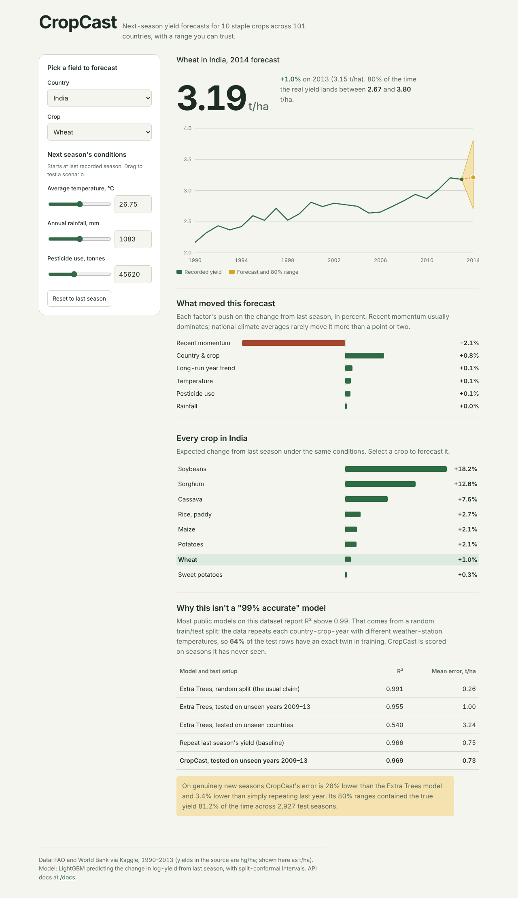

# CropCast

Next-season crop yield forecasts for 10 staple crops across 101 countries, with calibrated 80% prediction intervals — and an honest look at why most models on this dataset report a misleading 99% R².



## The finding

The FAO/World Bank crop-yield dataset on Kaggle (`yield_df.csv`, 28,242 rows) is widely used to train models that report R² ≈ 0.99. I reproduced that number (Extra Trees, random 80/20 split: **R² 0.991**) and then checked how it was earned.

The dataset repeats each country-crop-year several times with different weather-station temperatures (13,130 unique country-crop-years, 28,242 rows). Under a random split, **64% of test rows have the exact same country, crop and year in the training set** — the model is matching twins, not forecasting.

Scored properly, on seasons the model has never seen:

| Model and test setup | R² | MAE (t/ha) |
|---|---:|---:|
| Extra Trees, random split (the usual claim) | 0.991 | 0.26 |
| Extra Trees, train ≤2008 → test 2009–13 | 0.955 | 1.00 |
| Extra Trees, unseen countries (5-fold grouped) | 0.540 | 3.24 |
| Baseline: repeat last season's yield | 0.966 | 0.75 |
| **CropCast, train ≤2008 → test 2009–13** | **0.969** | **0.73** |

CropCast cuts future-season error by 28% versus the Extra Trees setup and beats the last-season baseline by 3.4%. Its 80% intervals contained the true yield **81.2%** of the time across 2,927 test seasons.

A second, less flattering finding the app reports openly: national annual climate averages barely move year-to-year yield (typically under ±1%). Most of the signal is recent momentum. Rich "what-if" climate curves on this data mostly reflect the model memorising countries.

## How it works

1. **Deduplicate** to one row per country-crop-year (mean temperature across stations).
2. **Reframe the target** as the change in log-yield from last season, so the model learns deviations instead of memorising levels.
3. **Features**: country, crop, year, rainfall, temperature, pesticides, plus momentum (`trend`, `lag1_vs_roll`) and deltas (`temp_d`, `pest_d`).
4. **LightGBM** with Huber loss, trained on ≤2008 and evaluated on 2009–13.
5. **Split-conformal intervals**: fit on ≤2005, take the 80th percentile of absolute residuals on 2006–08, apply that width to every forecast.
6. **Explanations** from LightGBM's per-prediction feature contributions, grouped into momentum, temperature, rainfall, pesticides, country & crop, and year trend.
7. Final model refit on all years; forecasts are for the season after each series' last record (2014 for most).

## Run locally

```bash
pip install -r requirements.txt
python train.py            # optional: rebuilds artifacts/ and prints the benchmark
uvicorn app:app --port 7860
```

Open http://localhost:7860. Interactive API docs are at `/docs`.

```bash
pytest -q                  # 8 API tests
```

## API

| Endpoint | Does |
|---|---|
| `GET /api/meta` | Countries, crops per country, benchmark numbers |
| `GET /api/history?area=India&item=Wheat` | Recorded yearly series |
| `POST /api/predict` | Forecast, 80% interval and drivers for one crop |
| `POST /api/compare` | Forecast every crop in a country under one scenario |
| `POST /api/sensitivity?variable=temp` | Forecast across a range of one input |

```bash
curl -X POST localhost:7860/api/predict -H 'Content-Type: application/json' \
  -d '{"area":"India","item":"Wheat","temp":27.5}'
```

`rain` (mm), `temp` (°C) and `pest` (tonnes) are optional; they default to the last recorded season.

## Deploy

**Hugging Face Spaces (free)**
1. Create a Space at huggingface.co/new-space and choose **Docker** → Blank.
2. Push this folder to it:
   ```bash
   git init && git lfs install && git lfs track "*.png"   # Spaces reject untracked binaries
   git add . && git commit -m "CropCast"
   git remote add space https://huggingface.co/spaces/<your-username>/cropcast
   git push space main
   ```
   When prompted for a password, use a Hugging Face access token with write scope. The YAML block at the top of this README configures the Space; the model and data files are plain text, so only the screenshot needs LFS.

**Render (free web service)**
New → Web Service → connect the GitHub repo → Runtime: Docker. Render sets `PORT`; the Dockerfile reads it.

## Project layout

```
app.py            FastAPI service
train.py          Audit, training, evaluation, conformal calibration
static/index.html Frontend (vanilla JS, hand-drawn SVG chart)
artifacts/        model.txt, meta.json (metrics), history.json
data/yield_df.csv Source data
tests/            API tests
```

## Credits

Data: FAO and World Bank, via the Kaggle "Crop Yield Prediction Dataset" (1990–2013). Inspired by [Fatima-Z/crop-yield-prediction-model](https://huggingface.co/Fatima-Z/crop-yield-prediction-model) (MIT), whose benchmark this project reproduces and re-evaluates.

## License

MIT
